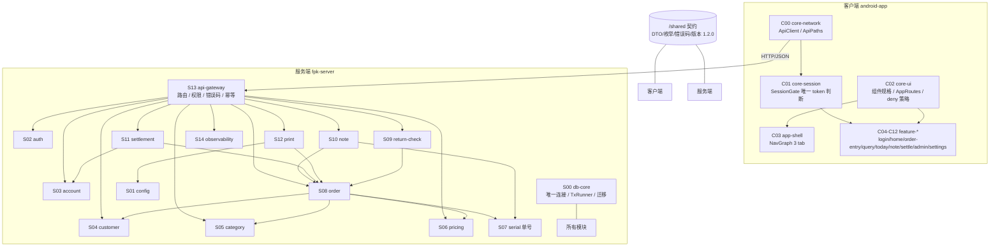

# 架构总览

建材进销存：门店 POS 形态的「服务端单体 + 手机客户端」。服务端是一个 Gradle 多模块 Kotlin 工程，
每个目录是一个模块，模块之间**只通过 Port 接口**通信；客户端与服务端共用 `/shared` 契约。

## 分层

## 数据流（一次「下单 → 结算 → 审计」）

1. phone → C06 录入页组装 `CreateOrderCmd`（只有型号 / 批号 / 单位 / 数量，客户端零计算）
2. `POST /orders`（带 `Idempotency-Key` = `client_request_id`）→ S13 鉴权 → 退货单先 S09 校验 → S08 建单
3. S08：S07 取号 → S06 解析单价 → 写 `order_header` / `order_line` → 派生总额 / 应收 / 已收
4. `POST /settlements` → S11 记录收款（应收从 S08 **重新读取**，不缓存）→ `POST /settlements/{no}/audit` 审核
5. 同事务写 S14 `audit_log`（改价、审核两类留痕），`GET /audit` 只读查询
6. `GET /print/{docNo}` → S12 渲染 80mm 文本（`text/plain`），打印次数落 `print_job` 台账

## 四条硬边界

| 边界 | 落地方式 | 守卫 |
| --- | --- | --- |
| **事务** | 所有写经 db-core `TxRunner`；跨 Port 调用同一事务（网关的建单 / 改价 / 审核） | 各模块事务单测 + S13 回滚用例 |
| **权限** | 只在 S13 `AuthGate`；业务 Port 签名无 token / 角色 | `RoleTableTest`、`E403` 只有 `AuthGate` 抛 |
| **打印** | 只在 S12；客户端 deny 打印关键词，只展示只读状态 | `scan-buttons.ps1` + C12 测试 |
| **单号** | 只由 S07 产出；S13 不暴露取号接口；业务模块无前缀字面量 | 各模块 boundary 测试 |

## 运行形态

- 常驻服务：`fpk-server/app` 的 `GatewayMain`（`./gradlew :fpk-server:app:runGateway`），SQLite 文件库，
  启动即迁移到最新版本（当前 800）；一次性自检是 `Main`（`run`）。
- 客户端：本机无 Android SDK，13 个模块以 JVM 模块 + JVM 单测验证；真实工程换 `android` library 插件即可。
- 契约版本：`shared` 的 `CONTRACT_VERSION = 1.2.0`，镜像文件 `shared/contract.version` 由测试强制核对。
