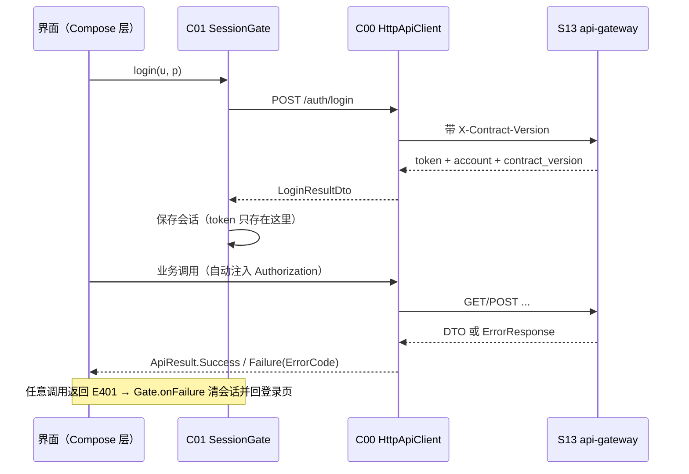

# 客户端总览（frontend）

客户端 13 个模块，全部为「界面无关的 JVM 层」：路由/页面规格、状态、网络调用与校验都在这里，
真实 Android 工程只需要把这些规格渲染成 Compose 组件（本机无 Android SDK）。

## 页面树

```text
AppShell (C03)
├── /login                       C04 登录页（账号 / 密码 / 服务端地址可改）
├── 底栏 tab 1：/home            C05 首页（5 个入口按钮）
│     ├── /orders/new?type=purchase          C06 采购下单
│     ├── /orders/new?type=direct            C06 直送下单
│     ├── /query                             C07 历史查询（按电话，只调聚合接口）
│     ├── /note                              C09 差异备注单（含「选原单」子页）
│     └── /settle                            C10 结算上传（成功/失败当场回显）
├── 底栏 tab 2：/today           C08 今日改单（复用 C06 录入壳，跨日由服务端锁）
├── 底栏 tab 3：/settings        C12 设置（服务端地址 + 只读打印状态）
├── /admin                       C11 管理后台（型号库 / 价格 / 结算审核 / 账号 4 子页）
└── /orders/new                  C06 四类录入页共用一个路由，只靠 orderType 区分
```

路由 id 的唯一真源：`android-app/core-ui/.../UiKit.kt` 的 `AppRoutes`；导航图由 C03 `NavGraph` 装配。

## 状态流



- **token 判断只在 C01**：其它模块不接触 token / Authorization；C00 只通过 `TokenProvider` 询问。
- **错误码统一在 C00 解析**：未知码保留原始串并走通用文案；网络故障归一为可重试的 `E503`。
- **金额 / 单号零计算**：DTO 里的金额、单号、批号全部原样展示；用户输入的金额只做格式搬运。

## 三个客户端硬边界

| 约束 | 落地 | 守卫 |
| --- | --- | --- |
| 打印只在服务端 | 客户端只有「打印状态」只读展示；打印关键词全局 deny | `ClientDenyPolicy` + `scan-buttons.ps1` + C12 测试 |
| 只调聚合接口 | 路径只能来自 C00 `ApiPaths`；无 SQL / 本地库 | C07 测试、各模块源码扫描 |
| 权限由服务端 | C11 无角色分支；越权 `E403` 原样回显 | C11 测试断言无 `Role` 引用 |

## 关键类

| 关注点 | 位置 |
| --- | --- |
| HTTP 客户端 / 接口清单 | `android-app/core-network` → `ApiClient`、`ApiPaths`、`HttpApiClient` |
| 登录态 / 导航守卫 | `android-app/core-session` → `SessionGate`、`SessionStore` |
| 组件规格 / 路由 id / deny 策略 | `android-app/core-ui` → `ScreenSpec`、`AppRoutes`、`ClientDenyPolicy` |
| 导航装配 / 组合根 | `android-app/app-shell` → `NavGraph`、`AppShell`、`ClientAssembly` |
| 四类录入共用表单 | `android-app/feature-order-entry` → `OrderFormComponent` |

## 验证

```bash
./gradlew :android-app:app-shell:test        # 9 例；同时把 12 个客户端模块编译进依赖
./gradlew :android-app:feature-order-entry:test
powershell -File docs/tools/scan-buttons.ps1 # 打印关键词扫描（0 违规）
```
